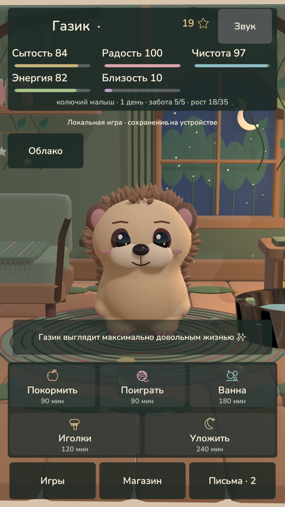

# Газик — лесной домик, 0.4.0

Исходный проект для **Unity 6.3 LTS 6000.3.26f1**. Газик самостоятельно гуляет, реагирует на прикосновения и участвует в пяти сценах ухода. Основа требований — итоговое ТЗ пользователя в [REQUIREMENTS.md](Documentation/REQUIREMENTS.md).

Проект запущен и проверен в настоящем Unity Editor. Ниже — кадр Game View, снятый движком через `ScreenCapture`; это игровой продукт.



## Запуск

1. Открой эту папку через Unity Hub. Версия редактора — 6000.3.26f1, для браузерной сборки нужен Web Build Support.
2. В меню выбери **Gazik → 1. Open home scene**, затем **Play** и вкладку **Game**.
3. Геометрия создаётся при запуске. До Play в сцене находится объект запуска. Если проект уже был открыт в Play во время обновления исходников, останови и снова запусти Play.

Альтернатива — `Open-Gazik.ps1 -UnityPath 'путь к Editor/Unity.exe'`.

## Игра

- Единая поверхность тела привязана к шести костям; голова, лапки, глаза, веки, щёки и иголки двигаются. Есть 20 состояний настроения и короткие жесты: подмигивание, язык, нюханье, чихание, ворчание, смущение, гордость и другие.
- Прогулки идут через свободную часть комнаты. Газик смотрит по ходу движения, затем разворачивается к игроку. Голова, нос, пузико и иголки имеют отдельные области касания.
- **Кормление:** подход, камера, четыре продукта в 3D, касание, полёт в рот, жевание, глоток и реакция на вкус.
- **Ванна:** ванночка с водой, крупный план, объёмная пена из множества мелких пузырьков. Губка удаляет пену непосредственно под пальцем.
- **Иголки:** камера показывает спину и бок; щётка снимает листики по месту прохода. После ухода Газик встряхивается.
- **Светлячки:** семь движущихся целей в 3D, касания, прыжки, две лапки, следы, поимки и забавные промахи. Для завершения нужно пять поимок.
- **Сон:** подход к лежанке, подъём, сворачивание, приглушение света и окна. Можно дождаться окончания 45 минут или разбудить раньше; повторной награды это не даёт.

Награда за уход начисляется после завершения взаимодействия. Кнопка «Вернуться» прерывает незаконченный уход без награды. Сохранены три дополнительные мини-игры: «Лови звёзды», «Яблочный бросок» и «Ёжовая память».

В домике есть пять зон, растения, лианы, корни, мох, грибы, камни, лес за окном, светящиеся баночки и ночной свет. Звуки действий и тихая процедурная лесная музыка выключаются кнопкой «Звук».

## Прогресс и магазин

Все **17 исходных товаров, их цены, описания и идентификаторы, 20 писем и пять названий стадий** сохранены и сверяются с отдельным снимком каталога сайта. Добавлены девять товаров: бандана, листик, очки, шапочка, плащ, светящаяся игрушка и три украшения. Часть новых вещей открывается с ростом.

Одежду и игрушки можно надевать, снимать и выбирать повторно без оплаты. Купленный декор убирается в инвентарь и возвращается в комнату. Вкусняшки сначала покупаются в запас, затем используются. Уход повышает привязанность; отсутствие её не уменьшает. Редкие находки ограничены по времени.

Сохранены прежние задержки ухода, награды, сон, скорости изменения потребностей, +8 звёзд и +8 XP за дневной круг и +3 звезды за рост. Рост теперь также открывает письмо. Питомец не погибает и не исчезает.

## Облако и резервные копии

В WebGL восстанавливается уже открытый разрешённый Firebase-сеанс. Используются прежний проект и документ **`pets/zvezdochka-hedgehog`**. Владелец ухаживает и меняет прогресс, второй разрешённый аккаунт наблюдает. Без разрешённого сеанса доступна отдельная локальная игра; войти можно через **Облако**.

Перед первой записью загружается серверное состояние. Локальная игра не отправляется поверх него. Неизвестные поля сохраняются; конфликт с другим устройством останавливает запись до повторной загрузки. Локальная и облачная копии хранятся отдельно. Есть два поколения локального сохранения, восстановление повреждённой копии, экспорт и проверяемый импорт JSON.

В Editor облако не подключается: он использует PlayerPrefs. Во время автоматических проверок применяется отдельное хранилище в памяти, поэтому настоящие сохранения не затрагиваются. Серверные правила и живые аккаунты требуют отдельной проверки — см. [Firebase](Documentation/FIREBASE.md).

## WebGL

**Gazik → 2. Build WebGL** создаёт `Builds/WebGL`. Шаблон — **GazikMobile**, начальный размер — **1080 × 1920**. Есть горизонтальный интерфейс, safe-area, две строки действий на телефоне и отдельные камеры. DPR ограничен 1,5; статичная геометрия объединяется; тени используют один каскад; светлячки не создают динамические источники света. Это меры оптимизации, а не измерение FPS телефона.

Открывать сборку нужно через HTTP/HTTPS. Для существующего сайта она предназначена в `/gazik/`; прежняя кнопка ёжика уже ведёт туда. Остальной романтический сайт менять не требуется.

## Проверки

```powershell
.\Tests\Run-Checks.ps1
.\Check-And-Build.ps1 -UnityPath 'путь к Editor/Unity.exe'
```

Первая команда требует .NET SDK 9 и Node.js; при нестандартном пути Node передай `-NodePath`. Вторая запускает реальный Play Mode, проверяет все пять взаимодействий, покупки и отсутствие награды за отмену, затем собирает WebGL через IL2CPP. Нативная проверка также доступна через **Gazik → 6. Run game smoke check**. Снимок Game View вручную: **Gazik → 3. Capture game screenshot**.

Текущие результаты, ограничения и критерии выпуска — в [QA.md](Documentation/QA.md). Браузерная проверка, реальные Firebase-аккаунты и замеры на физическом телефоне отделены от проверок Unity и не считаются пройденными автоматически.

## Исходники и лицензии

Модель, риг, дом, пена, взаимодействия, музыка и звуки создаются внутри проекта. Внешний Animator/FBX-пакет и платные ассеты не нужны. Шрифт Gazik UI основан на Nunito и Noto Emoji; оба текста SIL OFL 1.1 приложены. Концепт в `Assets/Gazik/Art` служит художественным ориентиром; снимки в `Documentation/Images` получены из Unity.
